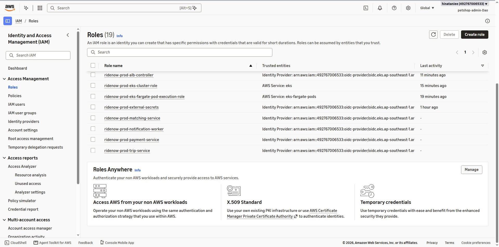
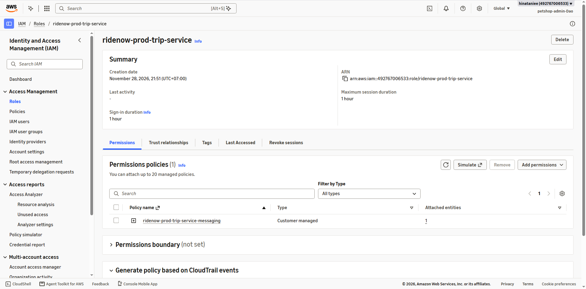
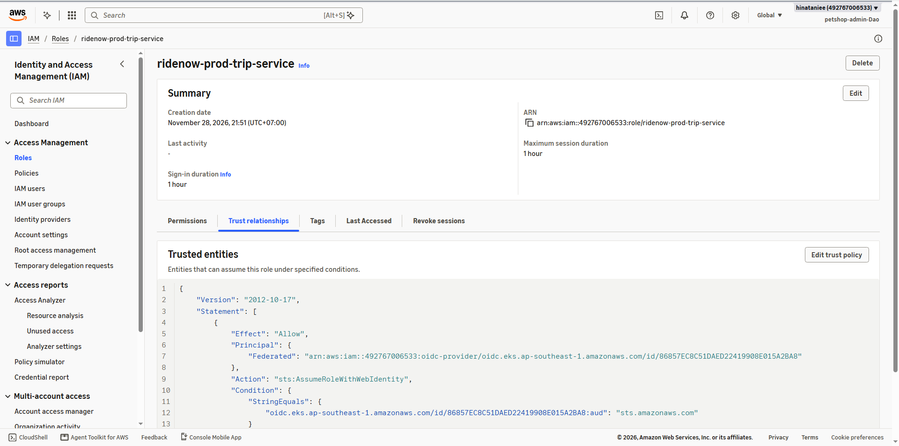
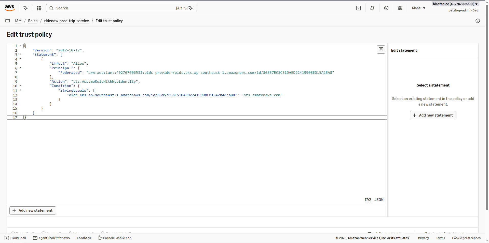
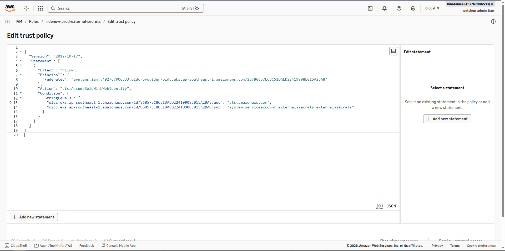

Trong phần này chúng ta sẽ thực hiện các phần gồm:

Tạo OIDC Identity Provider để thiết lập cơ chế xác thực giữa Kubernetes và AWS IAM.

Tạo IAM Roles for Service Accounts (IRSA), cho phép từng Kubernetes Service Account đảm nhận IAM Role tương ứng và truy cập các dịch vụ AWS theo quyền được cấp.

## Tạo OIDC Identity Provider cho EKS
OIDC (OpenID Connect) Identity Provider cho phép AWS IAM xác thực danh tính của Kubernetes Service Account thông qua OpenID Connect token do EKS cấp.

Đây là bước cần thiết để triển khai **IAM Roles for Service Accounts (IRSA)**, cho phép các Pod sử dụng IAM Role tương ứng để truy cập các dịch vụ AWS mà không cần lưu trữ AWS Access Key và Secret Key trực tiếp trong ứng dụng.


Trước tiên, cần lấy OIDC Issuer URL của cluster `ridenow-prod`:

- Truy cập **AWS Console → Elastic Kubernetes Service (EKS) → Clusters**.
- Chọn cluster `ridenow-prod` tại region `ap-southeast-1`.


- Trong tab **Overview**, tìm phần **OpenID Connect provider URL**


OIDC Issuer URL có dạng:

```text
https://oidc.eks.ap-southeast-1.amazonaws.com/id/XXXXXXXXXXXX
```

Sao chép URL này để sử dụng trong bước tiếp theo.


- Truy cập **AWS Console → IAM → Identity providers → Add provider**.


- Cấu hình các thông tin:
  - **Provider type:** `OpenID Connect`.
  - **Provider URL:** Dán OIDC Issuer URL vừa lấy từ EKS Cluster.
  - **Audience:** `sts.amazonaws.com`.
- Chọn **Add provider** để tạo Identity Provider.


Sau khi tạo thành công, IAM đã có OIDC Identity Provider tương ứng với EKS Cluster `ridenow-prod`. Provider này sẽ được sử dụng trong Trust Policy của các IAM Role ở bước cấu hình IRSA.

## Tạo IAM Roles for Service Accounts (IRSA)


Sau khi tạo OIDC Identity Provider, bước tiếp theo là tạo IAM Role và liên kết với các Kubernetes Service Account tương ứng.

Mỗi IAM Role sẽ đại diện cho một Service Account và được cấp quyền truy cập AWS theo đúng chức năng của ứng dụng. Trong phần này, chúng ta sẽ tạo sáu IAM Role cho AWS Load Balancer Controller, External Secrets và các service của RideNow.

**Tạo IAM Role cho AWS Load Balancer Controller**

Truy cập **AWS Console → IAM → Roles → Create role**.


Cấu hình Trusted entity:

- **Trusted entity type:** `Web identity`.
- **Identity provider:** Chọn OIDC Provider đã tạo ở bước trước.
- **Audience:** `sts.amazonaws.com`.

Chọn **Next**.


Tại bước **Add permissions**, chọn **Next** để tiếp tục.


Tại bước đặt tên Role, cấu hình:

- **Role name:** `ridenow-prod-alb-controller`.
- **Description:** Để trống.

Chọn **Create role** để hoàn tất.

Lưu ý: Role này cần được gắn policy chứa các quyền cần thiết cho AWS Load Balancer Controller. Nếu policy chưa được tạo, cần bổ sung sau khi hoàn tất việc tạo Role.

**Tạo IAM Role cho External Secrets**


Thực hiện tương tự các bước tạo Role ở trên, với tên:

`ridenow-prod-external-secrets`

Tại bước **Add permissions**, tạo một Inline Policy để cho phép External Secrets đọc các thông tin bí mật từ AWS Secrets Manager.

Chọn **Add permissions → Create inline policy**, chuyển sang tab **JSON** và nhập policy sau:


```json
{
  "Version": "2012-10-17",
  "Statement": [
    {
      "Effect": "Allow",
      "Action": [
        "secretsmanager:GetSecretValue",
        "secretsmanager:DescribeSecret"
      ],
      "Resource": [
        "arn:aws:secretsmanager:ap-southeast-1:<ACCOUNT_ID>:secret:ridenow-prod-*",
        "arn:aws:secretsmanager:ap-southeast-1:<ACCOUNT_ID>:secret:rds!db-*"
      ]
    }
  ]
}
```

Thay `<ACCOUNT_ID>` bằng AWS Account ID của bạn.

Đặt tên policy và lưu lại. Sau đó hoàn tất việc tạo Role với tên `ridenow-prod-external-secrets`.


**Tạo IAM Role cho các service của RideNow**


Tiếp theo, tạo IAM Role cho các service còn lại. Mỗi Role sẽ được gắn với một Kubernetes Service Account và một Managed Policy tương ứng.

| Role name | Service Account (`namespace:name`) | Permissions |
|---|---|---|
| `ridenow-prod-trip-service` | `ridenow:trip-service` | `ridenow-prod-trip-service-messaging` |
| `ridenow-prod-payment-service` | `ridenow:payment-service` | `ridenow-prod-payment-service-messaging` |
| `ridenow-prod-matching-service` | `ridenow:matching-service` | `ridenow-prod-matching-service-messaging` |
| `ridenow-prod-notification-worker` | `ridenow:notification-worker` | `ridenow-prod-notification-worker-messaging` |

Lặp lại các bước sau cho từng Role trong bảng:

- Truy cập **IAM → Roles → Create role**.
- Chọn **Trusted entity type:** `Web identity`.
- Chọn OIDC Provider đã tạo ở bước trước.
- Đặt **Audience:** `sts.amazonaws.com`.
- Chọn **Next**.
- Tại mục **Add permissions**, tìm và chọn Managed Policy tương ứng trong bảng.
- Chọn **Next**.
- Đặt **Role name** theo bảng, để trống **Description**.
- Chọn **Create role**.

Sau khi hoàn tất, chúng ta sẽ có tổng cộng sáu IAM Role tương ứng với sáu Service Account của hệ thống.

## Cập nhật Trust Policy cho các IAM Role

Sau khi tạo Role, cần cập nhật Trust Policy để giới hạn Service Account nào được phép sử dụng IAM Role tương ứng thông qua OIDC.

Thực hiện lần lượt cho cả sáu Role:

- Truy cập **IAM → Roles** và tìm Role cần cập nhật.
- Mở tab **Trust relationships**.
- Chọn **Edit trust policy**.
- Thay thế nội dung hiện tại bằng Trust Policy tương ứng với Role.
- Chọn **Update policy** để lưu.

Trong Trust Policy, cần cấu hình chính xác hai điều kiện:

- `aud`: Audience phải là `sts.amazonaws.com`.
- `sub`: Phải khớp với Kubernetes Service Account theo định dạng `system:serviceaccount:<namespace>:<service-account-name>`.

Ví dụ, với Role `ridenow-prod-trip-service`, giá trị `sub` phải là:

```text
system:serviceaccount:ridenow:trip-service
```








```json


{
  "Version": "2012-10-17",
  "Statement": [
    {
      "Effect": "Allow",
      "Principal": {
        "Federated": "arn:aws:iam::492767006533:oidc-provider/oidc.eks.ap-southeast-1.amazonaws.com/id/86857EC8C51DAED22419908E015A2BA8"
      },
      "Action": "sts:AssumeRoleWithWebIdentity",
      "Condition": {
        "StringEquals": {
          "oidc.eks.ap-southeast-1.amazonaws.com/id/86857EC8C51DAED22419908E015A2BA8:aud": "sts.amazonaws.com",
          "oidc.eks.ap-southeast-1.amazonaws.com/id/86857EC8C51DAED22419908E015A2BA8:sub": "system:serviceaccount:ridenow:trip-service"
        }
      }
    }
  ]
}

```
Các Role còn lại cũng cần thay đổi `sub` tương ứng theo bảng Service Account ở trên.

Role	sub
alb-controller	system:serviceaccount:kube-system:aws-load-balancer-controller
external-secrets	system:serviceaccount:external-secrets:external-secrets
trip-service	system:serviceaccount:ridenow:trip-service
payment-service	system:serviceaccount:ridenow:payment-service
matching-service	system:serviceaccount:ridenow:matching-service
notification-worker	system:serviceaccount:ridenow:notification-worker




**Lưu ý:** OIDC Provider, Audience và Service Account trong Trust Policy phải khớp chính xác. Nếu cấu hình sai, Pod sẽ không thể sử dụng IAM Role thông qua IRSA.