## Post-deploy steps

kiểm tra đã đăng nhập aws
```bash

aws sts get-caller-identity
```
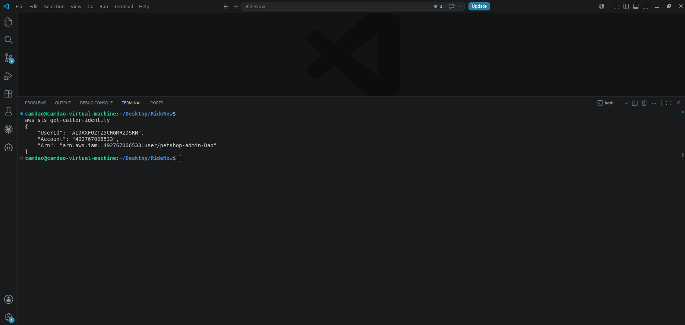
1. Cấu hình tới Kubeconfig
```bash
aws eks update-kubeconfig --name ridenow-prod --region ap-southeast-1

kubectl get svc kubernetes
```

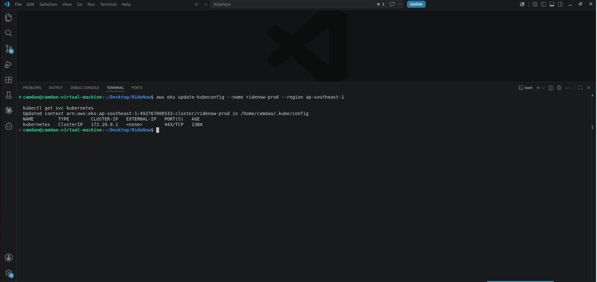

như vậy là đã kết nối tới kubernetes

2. CoreDNS on Fargate

CoreDNS là DNS server nội bộ của Kubernetes. Nó giúp các Pod tìm thấy nhau thông qua tên Service, ví dụ backend.default.svc.cluster.local.

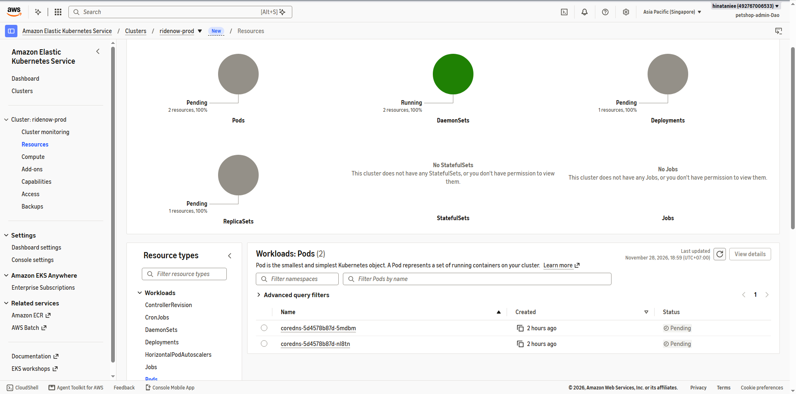

Mục tiêu của bước CoreDNS on Fargate là chuyển các Pod CoreDNS đang chạy trên EC2 sang chạy trên AWS Fargate.

Kiểm tra và xóa annotation ghim EC2

```bash

if kubectl get deployment coredns -n kube-system \
     -o jsonpath='{.spec.template.metadata.annotations}' | grep -q compute-type; then
  kubectl patch deployment coredns -n kube-system --type=json \
    -p='[{"op":"remove","path":"/spec/template/metadata/annotations/eks.amazonaws.com~1compute-type"}]'
fi

kubectl rollout restart deployment coredns -n kube-system
kubectl rollout status  deployment coredns -n kube-system

```

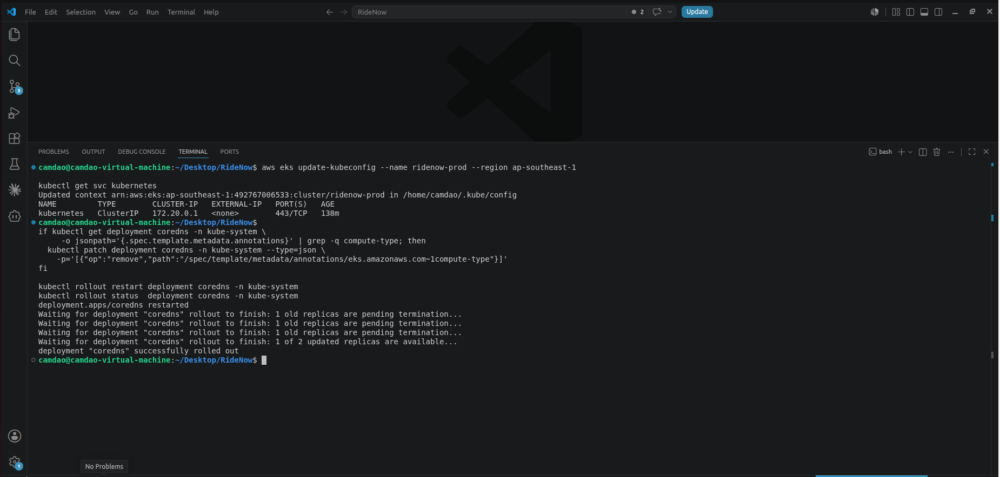


1. cài AWS Load Balancer Controller vào EKS để Kubernetes có thể tự động tạo và quản lý AWS Application Load Balancer (ALB).

AWS Load Balancer Controller là một Kubernetes Controller chạy bên trong Amazon EKS, có nhiệm vụ tự động tạo, cấu hình và quản lý AWS Load Balancer dựa trên các tài nguyên Kubernetes như Ingress và Service.

Nói đơn giản: Nó là cầu nối giữa Kubernetes và AWS Load Balancing.

Đây là một CLI exception: controller được phát hành dưới dạng Helm chart, và tệp policy phụ thuộc vào phiên bản chart. Cài controller bằng Helm, dùng role ARN và VPC id từ Set variables:


Cài đặt công cụ
```bash
helm repo add eks https://aws.github.io/eks-charts && helm repo update
```
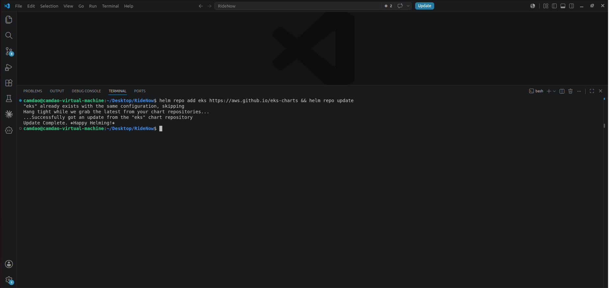
```bash
helm install aws-load-balancer-controller eks/aws-load-balancer-controller \
  -n kube-system \
  --set clusterName="ridenow-prod" \
  --set serviceAccount.create=true \
  --set serviceAccount.name=aws-load-balancer-controller \
  --set "serviceAccount.annotations.eks\.amazonaws\.com/role-arn=arn:aws:iam::492767006533:role/ridenow-prod-alb-controller" \
  --set region="ap-southeast-1" \
  --set vpcId="vpc-07fb2f19095f49f95"
```

Thông tin	Giá trị	Lấy từ đâu

Cluster Name	ridenow-prod	EKS → Clusters

AWS Account ID	492767006533	AWS Console → Account ID

IAM Role ARN	ARN của role	IAM → Roles → ridenow-prod-alb-controller

Region	ap-southeast-1	Region trên AWS Console

VPC ID	vpc-07fb2f19095f49f95	VPC → Your VPCs

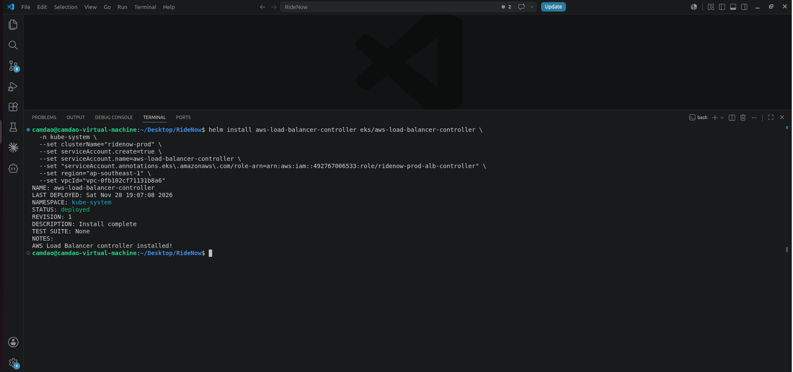

Hiện tại bạn đã cài Controller bằng Helm, nhưng Controller cần quyền gọi AWS API để tạo và quản lý Application Load Balancer (ALB), Target Group, Listener và các tài nguyên liên quan.

Nếu thiếu quyền, Controller có thể ghi log AccessDenied và Ingress không được cấp địa chỉ ALB.

```bash
helm list -n kube-system
```
Controller Version	v3.7.0

```bash
mkdir -p .tmp

CONTROLLER_VERSION="v3.7.0"

echo "controller version: $CONTROLLER_VERSION"

curl -fsSL -o .tmp/alb-controller-iam-policy.json \
  "https://raw.githubusercontent.com/kubernetes-sigs/aws-load-balancer-controller/${CONTROLLER_VERSION}/docs/install/iam_policy.json"
```


Kết quả mong đợi: một dòng `controller version: v...` và tệp `.tmp/alb-controller-iam-policy.json`.

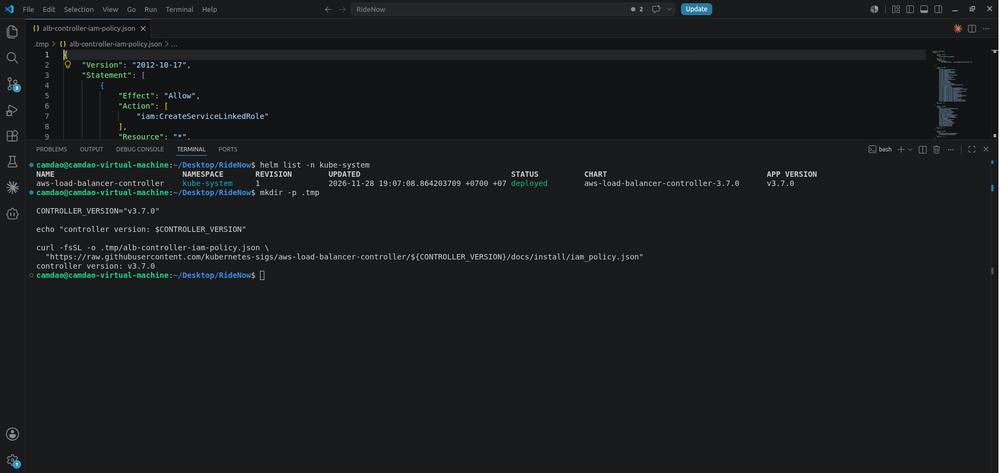

Tạo và gắn policy trong IAM console:

1. Vào **IAM -> Policies -> Create policy -> JSON** tab. Dán nội dung của `.tmp/alb-controller-iam-policy.json`.
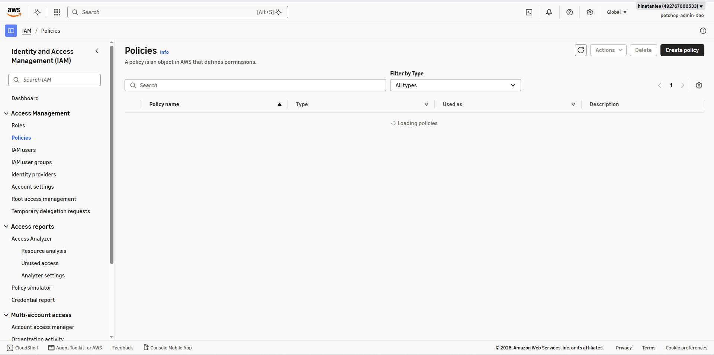
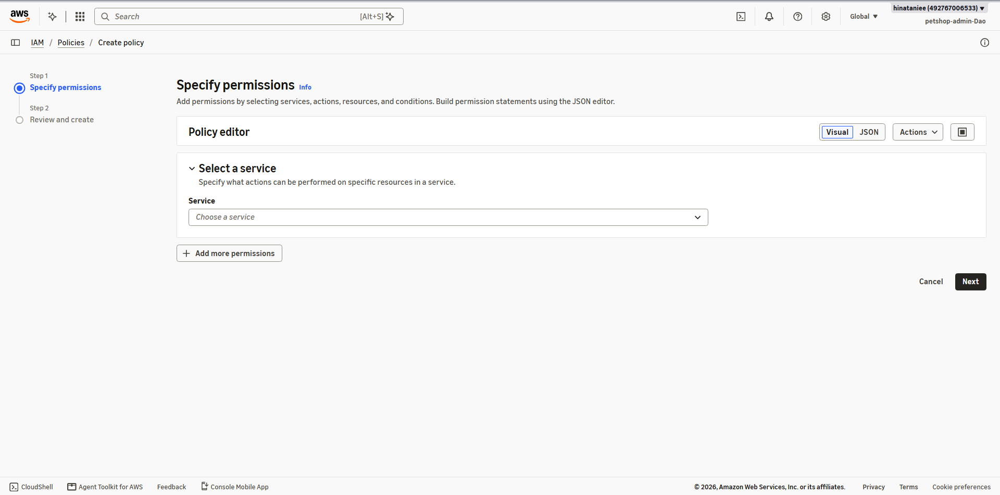
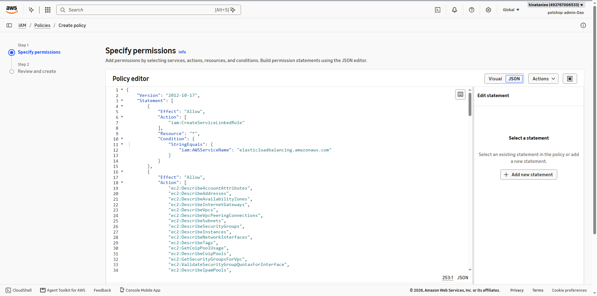

1. Đặt tên policy là `AWSLoadBalancerControllerIAMPolicy`, rồi tạo.
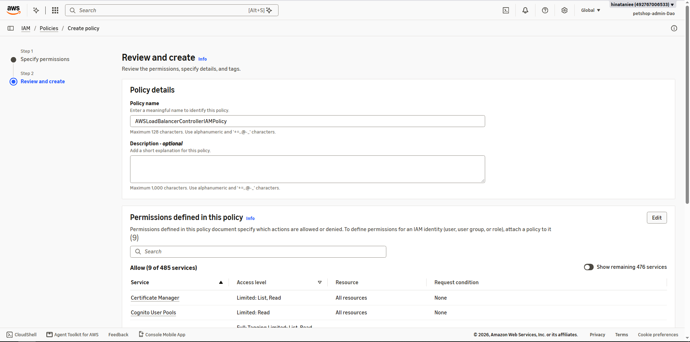
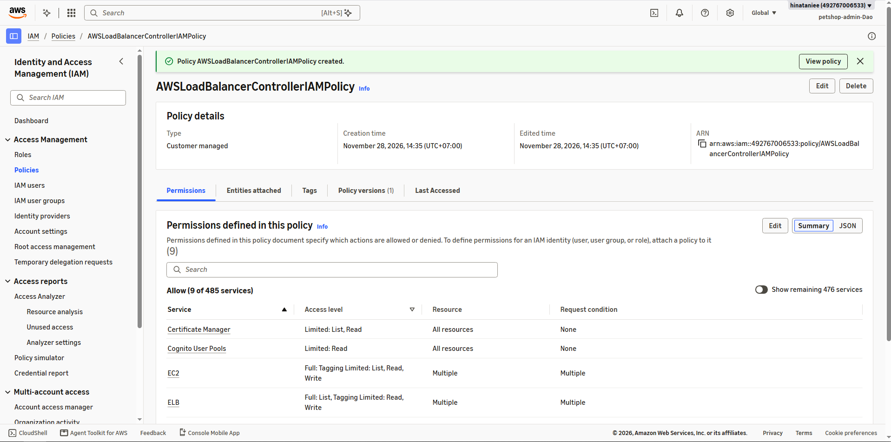
1. Vào **IAM -> Roles -> `ridenow-prod-alb-controller` -> Add permissions -> Attach policies**.

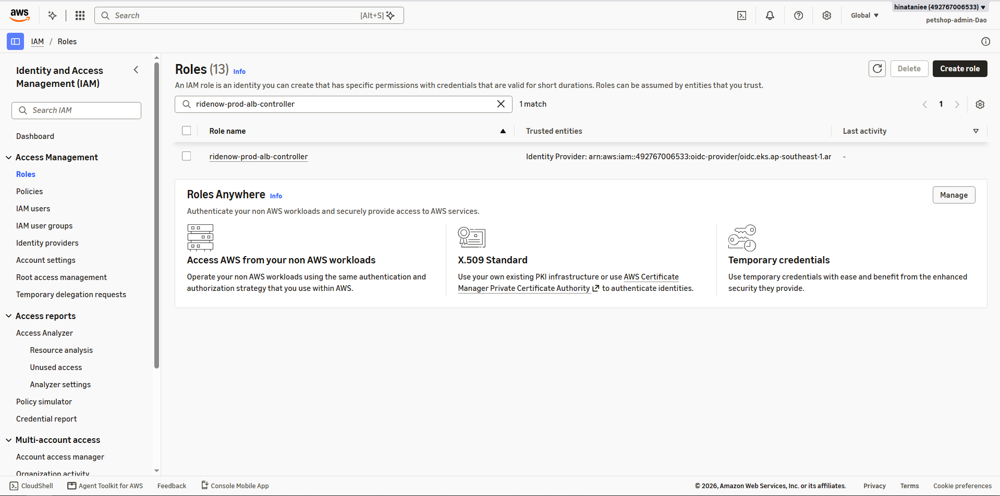
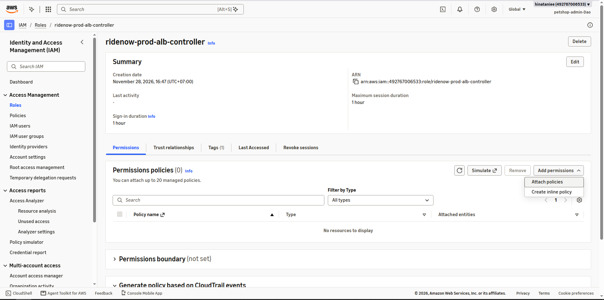

4. Chọn `AWSLoadBalancerControllerIAMPolicy`, rồi chọn **Add permissions**.
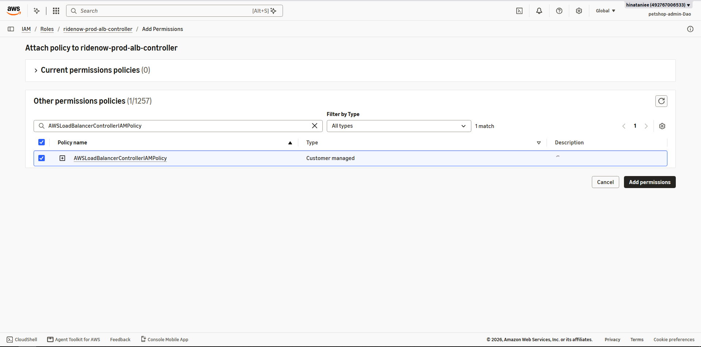
Sau đó restart controller để nó nhận quyền:

```bash
kubectl rollout restart deployment aws-load-balancer-controller -n kube-system
kubectl rollout status  deployment aws-load-balancer-controller -n kube-system --timeout=300s
kubectl get deploy -n kube-system aws-load-balancer-controller
```

Kết quả ở cột đã READY.
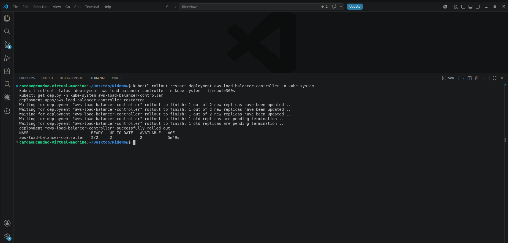


### 4. External Secrets Operator


Chúng ta cần lấy ARN:
- Mở AWS KMS → Customer managed keys.
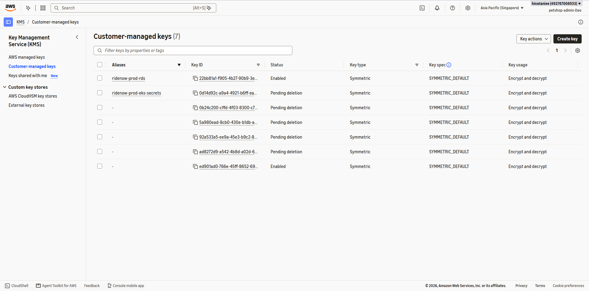
- Chọn alias ridenow-prod-rds.
- Sao chép Key ARN.
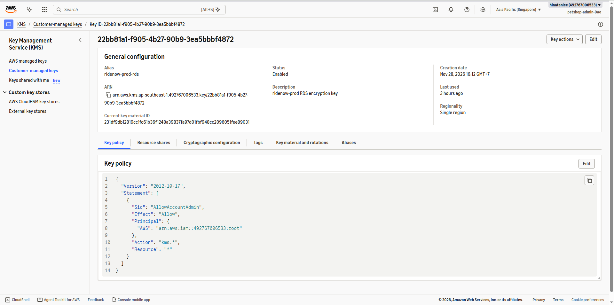
Cấp quyền KMS Decrypt cho IAM Role

Truy cập AWS Console → IAM → Roles.

Tìm role:

ridenow-prod-external-secrets

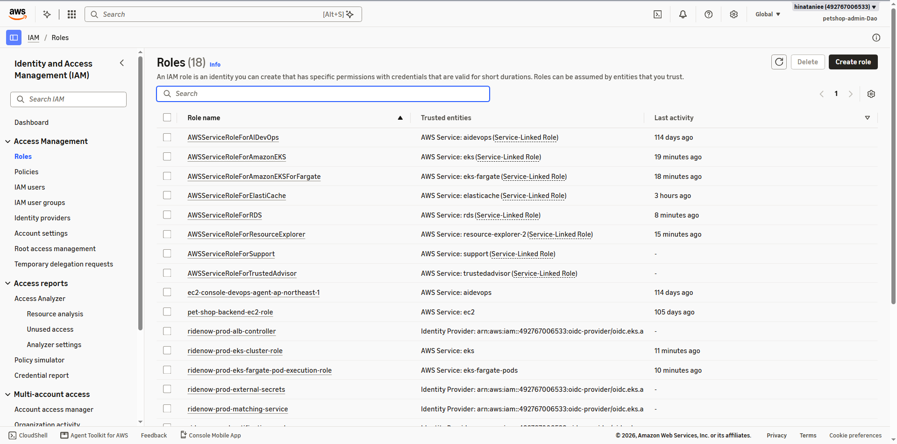

Thực hiện:
- Chọn tab Permissions.
- Chọn Add permissions → Create inline policy.
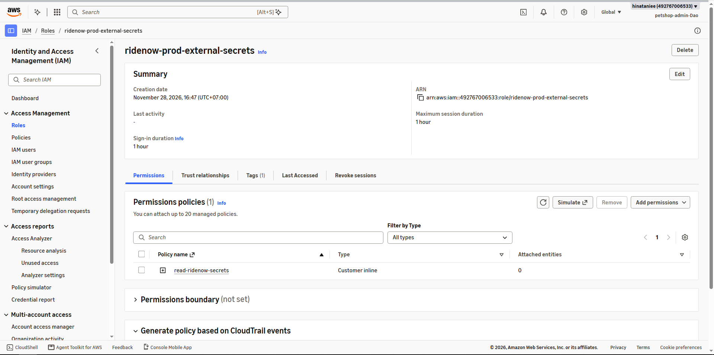
- Chuyển sang tab JSON.
- Dán policy sau:

{
  "Version": "2012-10-17",
  "Statement": [
    {
      "Effect": "Allow",
      "Action": [
        "kms:Decrypt",
        "kms:DescribeKey"
      ],
      "Resource": "YOUR_RDS_KMS_KEY_ARN"
    }
  ]
}

Thay YOUR_RDS_KMS_KEY_ARN bằng ARN của khóa KMS RDS.

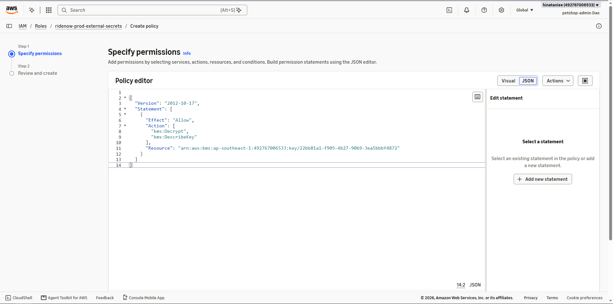

Tiếp tục:
- Chọn Next.
- Policy name: ridenow-prod-external-secrets-kms.
- Chọn Create policy.
Sau bước này, role External Secrets đã có quyền giải mã secret bằng KMS.


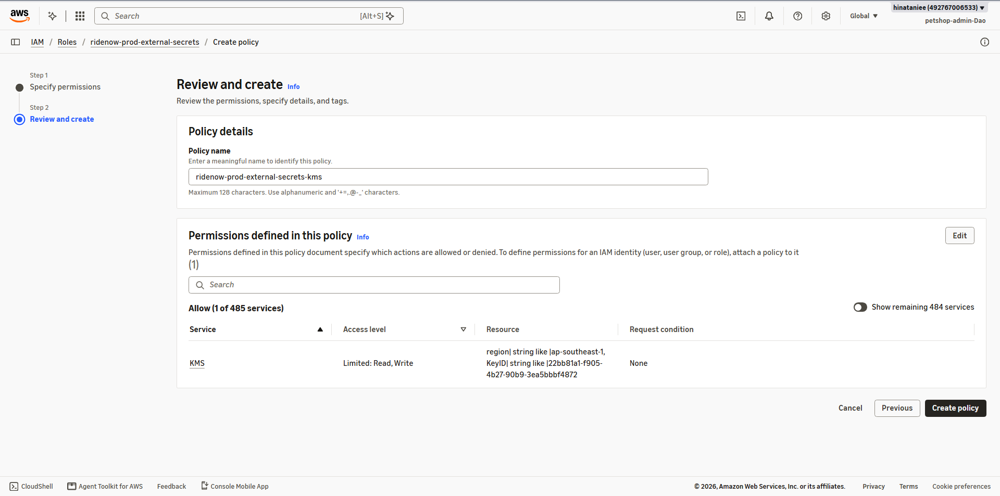

Sau khi tạo xong chúng ta lấy ARN của IAM Role ridenow-prod-external-secrets.

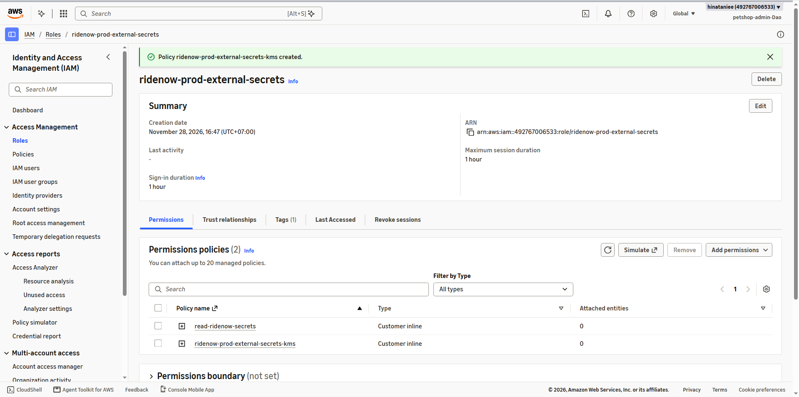


Đây là một CLI exception: operator được phát hành dưới dạng Helm chart.

```bash
helm repo add external-secrets https://charts.external-secrets.io && helm repo update

# webhook.port=9443 is required on Fargate (the default 10250 clashes with the kubelet)
helm install external-secrets external-secrets/external-secrets \
  -n external-secrets --create-namespace \
  --set serviceAccount.annotations."eks\.amazonaws\.com/role-arn"="arn:aws:iam::492767006533:role/ridenow-prod-external-secrets" \
  --set webhook.port=9443 \
  --wait

kubectl get pods -n external-secrets
kubectl get crd | grep external-secrets.io
```

serviceAccount.annotations."eks\.amazonaws\.com/role-arn"="$EXTERNAL_SECRETS_ROLE_ARN" \

Kết quả mong đợi: ba pod `Running` và các CRD `external-secrets.io` được liệt kê.


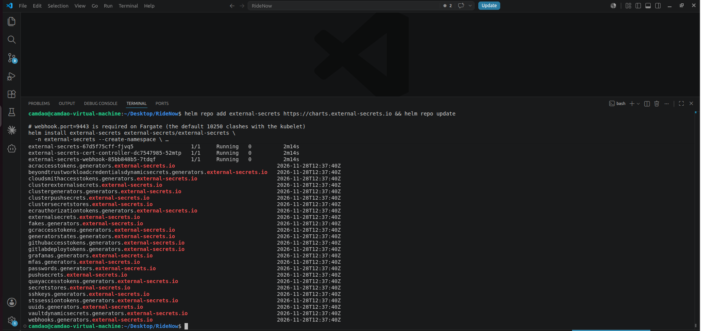

### 5. Namespace

Đây là một CLI exception: namespace là đối tượng Kubernetes lấy từ một manifest trong repository.

```bash
kubectl apply -f iac/k8s/00-namespace.yaml
kubectl get namespace ridenow
```

Kết quả mong đợi: namespace `ridenow` có trạng thái `Active`.

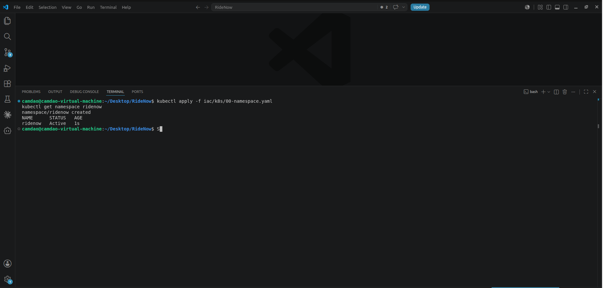
### 6. Pod networking (per-pod security groups)

Bước 1: Tạo sáu Security Group

Truy cập:

EC2 → Security Groups → Create security group
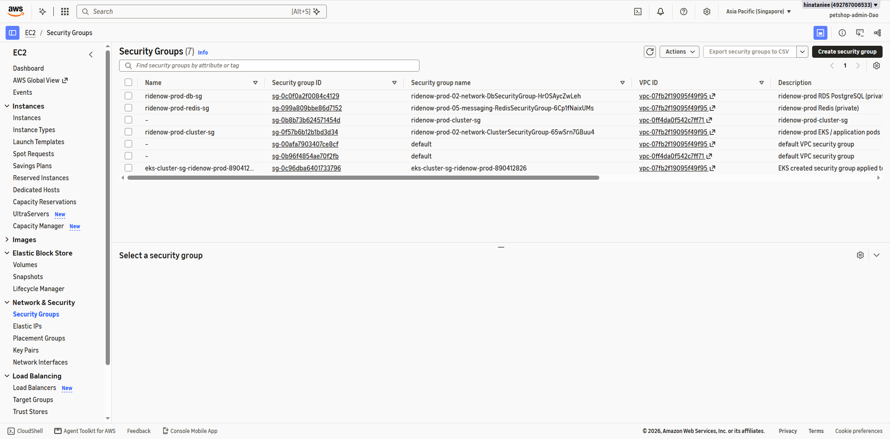

Tạo lần lượt sáu group:

Security Group	Description

ridenow-prod-user-service-sg	user-service pods

ridenow-prod-driver-service-sg	driver-service pods

ridenow-prod-trip-service-sg	trip-service pods

ridenow-prod-payment-service-sg	payment-service pods

ridenow-prod-matching-service-sg	matching-service pods

ridenow-prod-notification-service-sg	notification-service pods

Cấu hình chung:
- VPC: ridenow-prod-vpc
- Inbound rules: để trống.
- Outbound rules: giữ mặc định All traffic.
- Tags: Name = tên Security Group tương ứng.

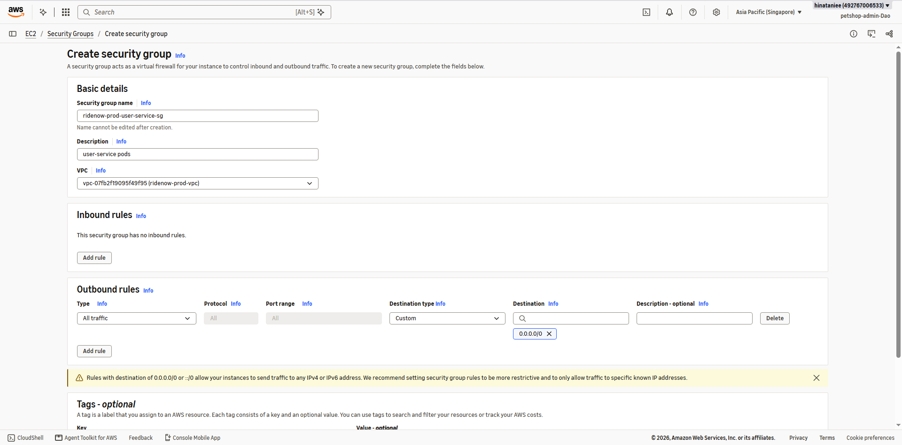
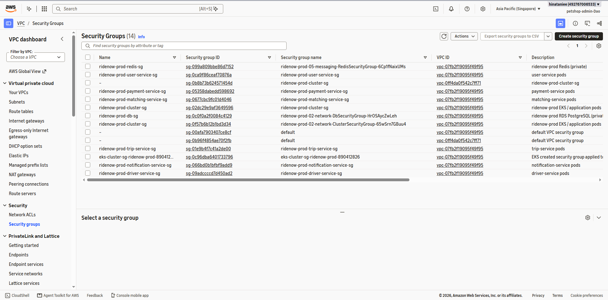
Bước 2: Cho phép truy cập Database

Truy cập:

EC2 → Security Groups → ridenow-prod-db-sg → Inbound rules → Edit inbound rules

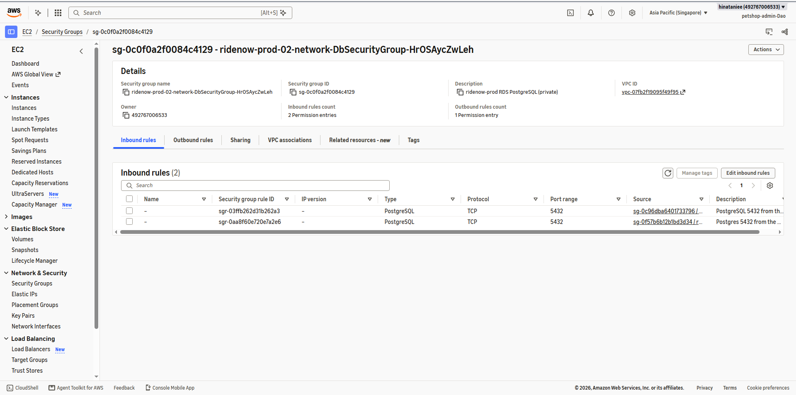
Thêm sáu rule:
Type	Port	Source
PostgreSQL	5432	user-service SG
PostgreSQL	5432	driver-service SG
PostgreSQL	5432	trip-service SG
PostgreSQL	5432	payment-service SG
PostgreSQL	5432	matching-service SG
PostgreSQL	5432	notification-service SG

Lưu ý: Source phải chọn Security Group tương ứng, không nhập địa chỉ IP.

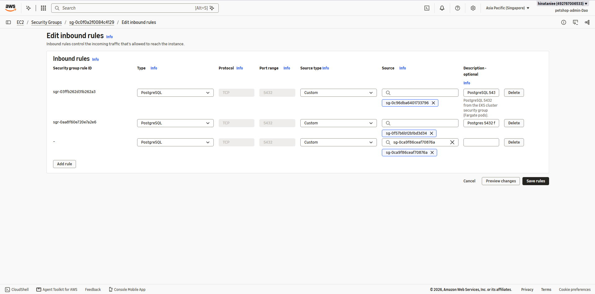
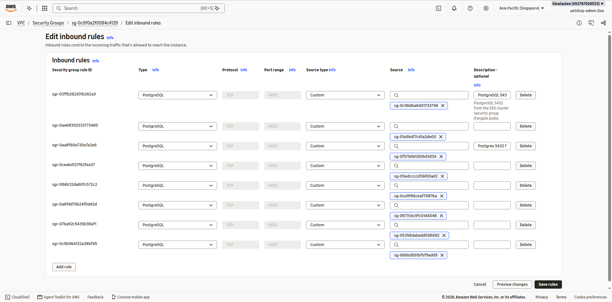
Đây là một CLI exception: `SecurityGroupPolicy` là đối tượng Kubernetes. Khối này đọc sáu group id và áp dụng các policy. `EKS_CLUSTER_SG_ID` vẫn nằm trên mọi pod vì DNS và Redis cần nó:

thay VPC_ID bằnng vpc thực
```bash
export ENV=prod
export VPC_ID=vpc-07fb2f19095f49f95
export AWS_DEFAULT_REGION=ap-southeast-1


EKS_CLUSTER_SG_ID=$(aws eks describe-cluster \
  --name ridenow-${ENV} \
  --region "$AWS_DEFAULT_REGION" \
  --query 'cluster.resourcesVpcConfig.clusterSecurityGroupId' \
  --output text)

if [[ ! "$EKS_CLUSTER_SG_ID" =~ ^sg-[a-f0-9]+$ ]]; then
  echo "ERROR: Cannot get EKS Cluster Security Group ID"
  exit 1
fi

echo "EKS Cluster SG: $EKS_CLUSTER_SG_ID"

mkdir -p .tmp
: > .tmp/sgp.yaml

for SVC in user driver trip payment matching notification; do

  SG_ID=$(aws ec2 describe-security-groups \
    --region "$AWS_DEFAULT_REGION" \
    --filters \
      "Name=vpc-id,Values=$VPC_ID" \
      "Name=tag:Name,Values=ridenow-${ENV}-${SVC}-service-sg" \
    --query 'SecurityGroups[0].GroupId' \
    --output text)

  if [[ ! "$SG_ID" =~ ^sg-[a-f0-9]+$ ]]; then
    echo "MISSING: ridenow-${ENV}-${SVC}-service-sg"
    continue
  fi

  APP=${SVC}-service
  [ "$SVC" = notification ] && APP=notification-worker

  cat >> .tmp/sgp.yaml <<EOF
---
apiVersion: vpcresources.k8s.aws/v1beta1
kind: SecurityGroupPolicy
metadata:
  name: ${APP}-sgp
  namespace: ridenow
spec:
  podSelector:
    matchLabels:
      app: ${APP}
  securityGroups:
    groupIds:
      - ${SG_ID}
      - ${EKS_CLUSTER_SG_ID}
EOF

  echo "$APP -> $SG_ID + $EKS_CLUSTER_SG_ID"

done

if ! grep -q 'kind: SecurityGroupPolicy' .tmp/sgp.yaml; then
  echo "ERROR: No valid SecurityGroupPolicy generated"
  exit 1
fi


kubectl apply --dry-run=server -f .tmp/sgp.yaml || exit 1

kubectl apply -f .tmp/sgp.yaml || exit 1

kubectl get namespace ridenow
kubectl get securitygrouppolicy -n ridenow
```
Kết quả mong đợi: sáu dòng `<name> -> sg-...` và sáu dòng `SecurityGroupPolicy`.

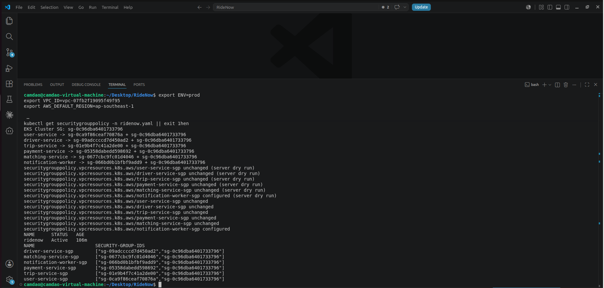

### 7. Fargate log router

Đây là một CLI exception: log router đọc một ConfigMap của Kubernetes.

```bash
kubectl apply -f - <<EOF
apiVersion: v1
kind: Namespace
metadata:
  name: aws-observability
  labels:
    aws-observability: enabled
---
apiVersion: v1
kind: ConfigMap
metadata:
  name: aws-logging
  namespace: aws-observability
data:
  flb_log_cw: "true"
  output.conf: |
    [OUTPUT]
        Name cloudwatch_logs
        Match kube.*
        region ${AWS_REGION}
        log_group_name /aws/eks/ridenow/fargate
        log_stream_prefix fargate-
        auto_create_group true
EOF
```

Kết quả mong đợi: `namespace/aws-observability created` và `configmap/aws-logging created`.
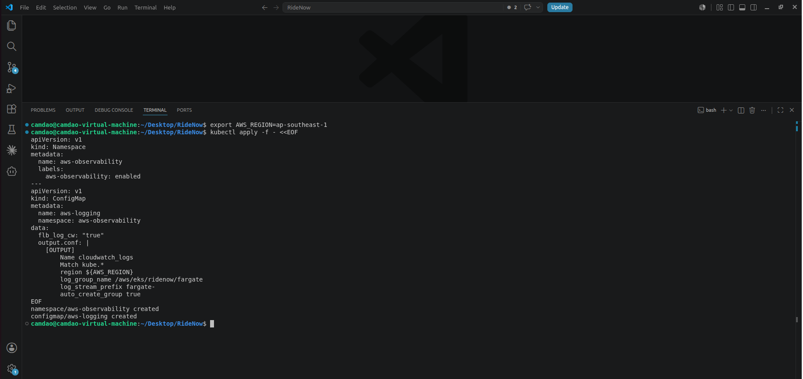

### 8. Database secrets (ExternalSecrets)
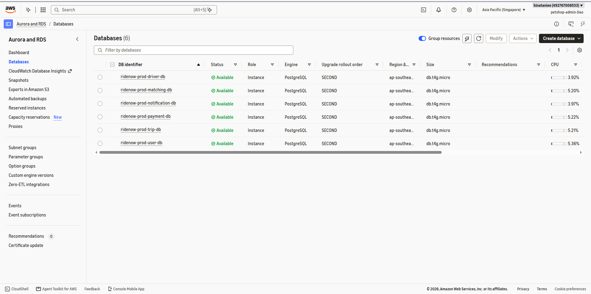

```bash
export ENV=prod
export AWS_REGION=ap-southeast-1

export DRIVER_DB_SECRET_ARN='arn:aws:secretsmanager:ap-southeast-1:492767006533:secret:rds!db-4d26b23d-1c8d-4575-997e-bd33a7d84502-HwqWqm'

export MATCHING_DB_SECRET_ARN='arn:aws:secretsmanager:ap-southeast-1:492767006533:secret:rds!db-4e868050-7980-4654-b9fa-4b608964de09-6xTXKj'

export NOTIFICATION_DB_SECRET_ARN='arn:aws:secretsmanager:ap-southeast-1:492767006533:secret:rds!db-2f1215f7-3152-4f5c-b215-a599960a3111-WlPj5L'

export PAYMENT_DB_SECRET_ARN='arn:aws:secretsmanager:ap-southeast-1:492767006533:secret:rds!db-774591fb-cb6e-4b96-bf5a-5ddbb7a935a2-RKYZau'

export TRIP_DB_SECRET_ARN='arn:aws:secretsmanager:ap-southeast-1:492767006533:secret:rds!db-3baf561c-9c96-4beb-8934-ecf0b23381f2-WXfbFz'

export USER_DB_SECRET_ARN='arn:aws:secretsmanager:ap-southeast-1:492767006533:secret:rds!db-88302dac-eff1-492c-92ee-804a7992f010-VOhQru'

```
Đây là một CLI exception: `ExternalSecret` là đối tượng Kubernetes, được điền từ manifest trong repository. Bước này cần sáu biến `*_DB_SECRET_ARN` từ Set variables (đều có giá trị) và bản cài External Secrets ở bước 4.

```bash
sed -e "s|[<]REGION[>]|$AWS_REGION|g" \
    -e "s|[<]ENV[>]|$ENV|g" \
    -e "s|[<]USER_SECRET_ARN[>]|$USER_DB_SECRET_ARN|g" \
    -e "s|[<]DRIVER_SECRET_ARN[>]|$DRIVER_DB_SECRET_ARN|g" \
    -e "s|[<]TRIP_SECRET_ARN[>]|$TRIP_DB_SECRET_ARN|g" \
    -e "s|[<]PAYMENT_SECRET_ARN[>]|$PAYMENT_DB_SECRET_ARN|g" \
    -e "s|[<]MATCHING_SECRET_ARN[>]|$MATCHING_DB_SECRET_ARN|g" \
    -e "s|[<]NOTIFICATION_SECRET_ARN[>]|$NOTIFICATION_DB_SECRET_ARN|g" \
    iac/k8s/10-external-secrets.yaml | kubectl apply -f -

kubectl get externalsecret -n ridenow
```

Kết quả mong đợi: sáu dòng có `SecretSynced` và READY `True`. Nếu một dòng hiển thị `SecretSyncedError`, hãy đọc lý do:

```bash
kubectl logs -n external-secrets deploy/external-secrets --tail=50 | grep -i "error\|denied"
```
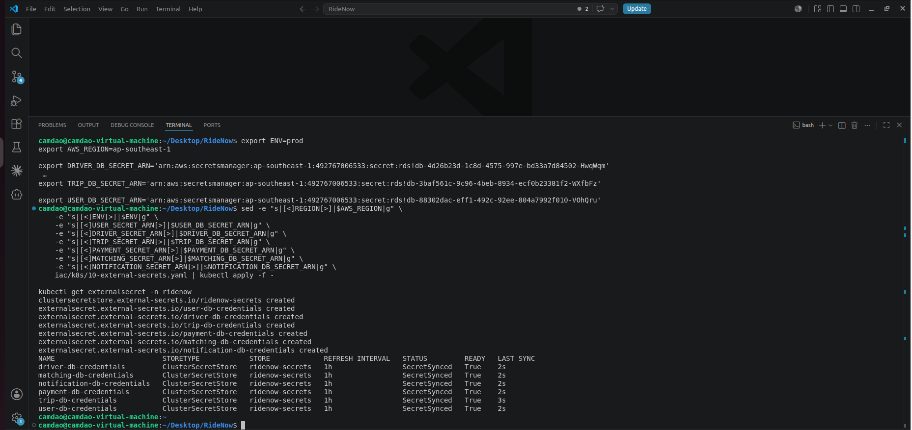

### 9. Build và push các image
``` bash

export ENV=prod
export AWS_REGION=ap-southeast-1

echo "ENV=$ENV"
echo "AWS_REGION=$AWS_REGION"

for ROLE in alb-controller external-secrets trip-service payment-service matching-service notification-worker; do
  echo "Checking ridenow-${ENV}-${ROLE}"

  aws iam get-role \
    --role-name "ridenow-${ENV}-${ROLE}" \
    --query 'Role.AssumeRolePolicyDocument.Statement[0].Condition.StringEquals' \
    --output json \
  | jq -r --arg r "$ROLE" \
    'to_entries[] | select(.key | endswith(":sub")) | "\($r)  \(.value)"'
done

```
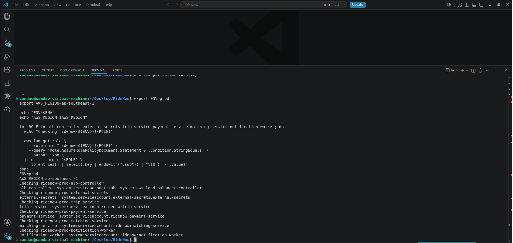

Nếu bạn đã push image ở mục 5.5 với cùng `IMAGE_TAG`, hãy bỏ qua bước này. Nếu chưa, chạy khối lệnh này khi Docker đang chạy:

```bash
export AWS_REGION=ap-southeast-1
export ENV=prod

export ACCOUNT_ID=$(aws sts get-caller-identity \
  --query Account \
  --output text)

export IMAGE_TAG=latest


REGISTRY="${ACCOUNT_ID}.dkr.ecr.${AWS_REGION}.amazonaws.com"
aws ecr get-login-password --region "$AWS_REGION" \
  | docker login --username AWS --password-stdin "$REGISTRY"
for SVC in user-service driver-service trip-service payment-service \
           matching-service notification-worker realtime-gateway; do
  docker buildx build --platform linux/amd64 \
    -t "$REGISTRY/ridenow/$SVC:$IMAGE_TAG" \
    --push "./$SVC"
done
```

Kết quả mong đợi: `Login Succeeded`, rồi bảy lần push thành công.
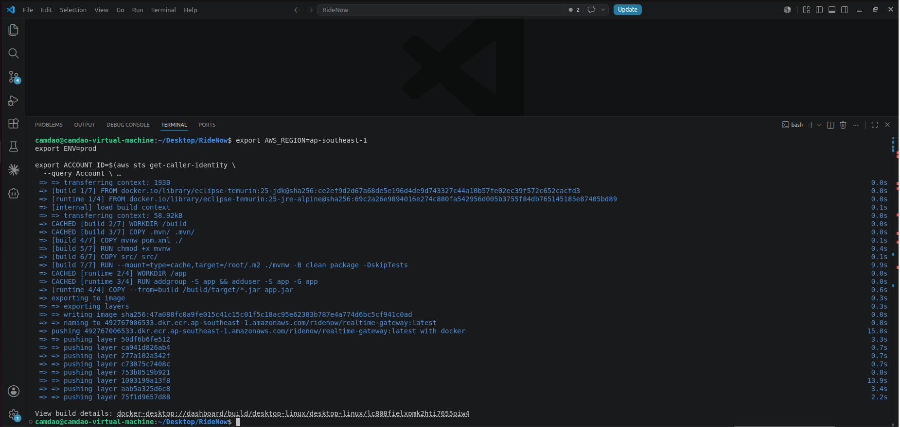

### 10. Đặt các biến cho workload

Bảy manifest chứa các giá trị mà bạn điền bằng biến. Hãy tra cứu các giá trị database, queue và cache mà các trang trước đã tạo:

```bash
USER_DB_ENDPOINT=$(aws rds describe-db-instances --db-instance-identifier "${CLUSTER_NAME}-user-db" --query 'DBInstances[0].Endpoint.Address' --output text 2>/dev/null)
DRIVER_DB_ENDPOINT=$(aws rds describe-db-instances --db-instance-identifier "${CLUSTER_NAME}-driver-db" --query 'DBInstances[0].Endpoint.Address' --output text 2>/dev/null)
TRIP_DB_ENDPOINT=$(aws rds describe-db-instances --db-instance-identifier "${CLUSTER_NAME}-trip-db" --query 'DBInstances[0].Endpoint.Address' --output text 2>/dev/null)
PAYMENT_DB_ENDPOINT=$(aws rds describe-db-instances --db-instance-identifier "${CLUSTER_NAME}-payment-db" --query 'DBInstances[0].Endpoint.Address' --output text 2>/dev/null)
MATCHING_DB_ENDPOINT=$(aws rds describe-db-instances --db-instance-identifier "${CLUSTER_NAME}-matching-db" --query 'DBInstances[0].Endpoint.Address' --output text 2>/dev/null)
NOTIFICATION_DB_ENDPOINT=$(aws rds describe-db-instances --db-instance-identifier "${CLUSTER_NAME}-notification-db" --query 'DBInstances[0].Endpoint.Address' --output text 2>/dev/null)
MATCHING_QUEUE_URL=$(aws sqs get-queue-url --queue-name "${CLUSTER_NAME}-matching" --query QueueUrl --output text 2>/dev/null)
PAYMENT_QUEUE_URL=$(aws sqs get-queue-url --queue-name "${CLUSTER_NAME}-payment" --query QueueUrl --output text 2>/dev/null)
NOTIFICATIONS_QUEUE_URL=$(aws sqs get-queue-url --queue-name "${CLUSTER_NAME}-notifications" --query QueueUrl --output text 2>/dev/null)
REDIS_ENDPOINT=$(aws elasticache describe-replication-groups --replication-group-id "${CLUSTER_NAME}-redis" --query 'ReplicationGroups[0].NodeGroups[0].PrimaryEndpoint.Address' --output text 2>/dev/null)
```

Các service chỉ nhận request từ một browser origin, và giá trị này không bao giờ là `*`. Đây là một Manual_Value. Bạn lấy nó từ trang frontend, vì domain CloudFront chỉ có sau khi bạn tạo nó. Hãy sao chép origin từ mục 5.10 (domain CloudFront, viết dưới dạng `https://` theo sau là domain) vào `<APP_ORIGIN>` trong khối lệnh tiếp theo. Nếu bạn chưa làm mục 5.10, hãy dùng `https://app.example.com` và áp dụng lại các manifest sau mục 5.10.

```bash
ORIGIN_URL="<APP_ORIGIN>"
[[ "$ORIGIN_URL" == https://* ]] || echo "STOP: ORIGIN_URL must start with https://. Replace the placeholder with your origin."

SUBST=()
for P in ACCOUNT_ID:ACCOUNT_ID REGION:AWS_REGION ENV:ENV IMAGE_TAG:IMAGE_TAG APP_ORIGIN:ORIGIN_URL \
         REDIS_ENDPOINT:REDIS_ENDPOINT USER_DB_ENDPOINT:USER_DB_ENDPOINT DRIVER_DB_ENDPOINT:DRIVER_DB_ENDPOINT \
         TRIP_DB_ENDPOINT:TRIP_DB_ENDPOINT PAYMENT_DB_ENDPOINT:PAYMENT_DB_ENDPOINT \
         MATCHING_DB_ENDPOINT:MATCHING_DB_ENDPOINT NOTIFICATION_DB_ENDPOINT:NOTIFICATION_DB_ENDPOINT \
         MATCHING_QUEUE_URL:MATCHING_QUEUE_URL PAYMENT_QUEUE_URL:PAYMENT_QUEUE_URL \
         NOTIFICATIONS_QUEUE_URL:NOTIFICATIONS_QUEUE_URL TRIP_SERVICE_ROLE_ARN:TRIP_SERVICE_ROLE_ARN \
         PAYMENT_SERVICE_ROLE_ARN:PAYMENT_SERVICE_ROLE_ARN MATCHING_SERVICE_ROLE_ARN:MATCHING_SERVICE_ROLE_ARN \
         NOTIFICATION_WORKER_ROLE_ARN:NOTIFICATION_WORKER_ROLE_ARN; do
  K=${P%%:*}
  V=${P#*:}
  [ -n "${!V}" ] && [ "${!V}" != "None" ] || echo "STOP: $V is empty. Create that resource first, then run this block again."
  SUBST+=(-e "s|<${K}>|${!V}|g")
done
```

Kết quả mong đợi: không có dòng `STOP`.

### 11. Triển khai bảy workload

Triển khai theo thứ tự này: payment trước trip, và driver trước matching. Fargate khởi động một node cho mỗi pod, nên một lần rollout có thể mất vài phút. Các file là `23-payment-service.yaml`, `20-user-service.yaml`, `21-driver-service.yaml`, `22-trip-service.yaml`, `24-matching-service.yaml`, `25-notification-worker.yaml` và `26-realtime-gateway.yaml`, đều nằm trong `iac/k8s/`.

```bash
for F in 23-payment-service 20-user-service 21-driver-service 22-trip-service \
         24-matching-service 25-notification-worker 26-realtime-gateway; do
  sed "${SUBST[@]}" iac/k8s/$F.yaml | kubectl apply -f -
  kubectl rollout status deployment/${F#*-} -n ridenow --timeout=900s
done
```

Kết quả mong đợi: bảy dòng `deployment "<service>" successfully rolled out`. Nếu một rollout lỗi, hãy chạy `kubectl describe pod -n ridenow -l app=<service>` và `kubectl logs -n ridenow deployment/<service> --tail=50`. Timeout tới PostgreSQL hoặc Redis nghĩa là thiếu các inbound rule ở bước 1 và 2, hoặc thiếu phần pod networking ở mục 5.8.

### 12. ALB ingress and smoke test

Hãy triển khai bảy service từ 5.9 trước. Lệnh kiểm tra HTTP 200 bên dưới chỉ thành công sau khi các service đang chạy. Payment phải chạy trước, vì trip-service gọi nó khi tạo chuyến đi. Đây là một CLI exception: Ingress là đối tượng Kubernetes, và controller ở bước 3 tạo load balancer từ nó.

```bash
kubectl apply -f iac/k8s/30-ingress.yaml
kubectl get ingress ridenow -n ridenow
```

Chạy lại lệnh thứ hai cho đến khi cột ADDRESS hiển thị một host name. Sau đó chạy smoke test:
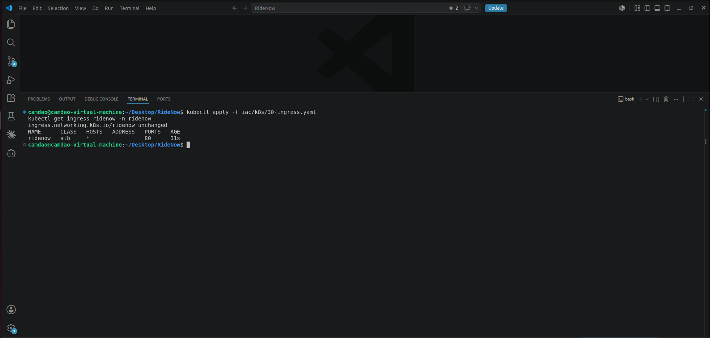


```bash
ALB_DNS_NAME=$(kubectl get ingress ridenow -n ridenow -o jsonpath='{.status.loadBalancer.ingress[0].hostname}')
echo "ALB_DNS_NAME=$ALB_DNS_NAME"
curl -s -o /dev/null -w "HTTP %{http_code}\n" "http://${ALB_DNS_NAME}/api/drivers"
kubectl logs -n ridenow deploy/matching-service --tail=20
kubectl logs -n ridenow deploy/notification-worker --tail=20
```

Kết quả mong đợi: một host name, `HTTP 200`, và log của matching và notification cho thấy consumer SQS và Valkey đã kết nối. Hãy giữ `ALB_DNS_NAME`, vì 5.10 dùng nó làm API origin của CloudFront.

`503` nghĩa là load balancer không có target khỏe. Chạy `kubectl get pods -n ridenow` và chờ đến khi mọi pod `Ready`. Một pod kẹt ở `0/1` thường do sai database endpoint, secret, security group hoặc Redis endpoint. Chạy `kubectl describe pod` trên pod đó để xem lý do.

Trang tiếp theo là 5.10 Frontend. Hãy làm sau khi Ingress `ridenow` đã có địa chỉ ALB.
